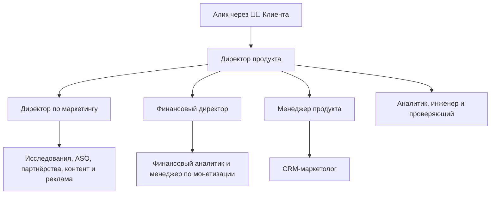

# Команда Midnight Dancer

Дата создания: 2026-11-09. Названия должностей согласованы с формулировкой владельца; пакет подготовлен к его приёмке.

Владелец общается через 🧑‍💼 Клиента с директором продукта. Директор управляет отделами, специалисты отчитываются своим руководителям. Сотрудники подключаются по задаче, не работают постоянно и не расходуют бюджет по умолчанию.

## Реестр должностей

| Должность | Руководитель | Инструкция |
|---|---|---|
| Директор продукта | Владелец | [Профиль](roles/product-director.md) |
| Директор по маркетингу | Директор продукта | [Профиль](roles/cmo.md) |
| Финансовый директор | Директор продукта | [Профиль](roles/cfo.md) |
| Менеджер продукта | Директор продукта | [Профиль](roles/product-manager.md) |
| Маркетинговый исследователь | Директор по маркетингу | [Профиль](roles/market-researcher.md) |
| Менеджер по партнёрствам и сообществу | Директор по маркетингу | [Профиль](roles/partnerships-manager.md) |
| Специалист по продвижению в магазинах приложений | Директор по маркетингу | [Профиль](roles/aso-specialist.md) |
| Контент-продюсер | Директор по маркетингу | [Профиль](roles/content-producer.md) |
| Специалист по платному привлечению | Директор по маркетингу | [Профиль](roles/performance-marketer.md) |
| CRM-маркетолог | Менеджер продукта | [Профиль](roles/crm-manager.md) |
| Продуктовый аналитик | Директор продукта | [Профиль](roles/product-analyst.md) |
| Финансовый аналитик | Финансовый директор | [Профиль](roles/financial-analyst.md) |
| Менеджер по монетизации | Финансовый директор | [Профиль](roles/monetization-manager.md) |
| Инженер по ИИ и интеграциям | Директор продукта | [Профиль](roles/ai-bridge.md) |
| Специалист по качеству и проверке результатов | Директор продукта | [Профиль](roles/quality-reviewer.md) |
| Технический руководитель | Директор продукта | [Профиль](roles/technical-lead.md) |
| Арт-директор | Директор по маркетингу | [Профиль](roles/art-director.md) |
| Моушн-дизайнер | Директор по маркетингу | [Профиль](roles/motion-designer.md) |

Машиночитаемый источник: [registry.json](registry.json). Профиль содержит промпт, входы/выходы, методики, границы и критерии.

## Работа

- [Старт нового чата](START-DIRECTOR.md), [правила](CONSTITUTION.md), [делегирование](ORCHESTRATION.md).
- [Основной цикл](workflows/PRODUCT-CYCLE.md), [запуск](workflows/LAUNCH.md), [проверки сценариев](validation/SCENARIOS.md).
- [Состояние](STATE.md), [решения](DECISIONS.md), [реестр волн](RUNS.md), [доступы](INTEGRATIONS.md).
- [Источники и происхождение методик](SOURCES.md). Проектные инструкции оригинальные; внешние агентные пакеты не установлены.

## Объём поставки

18 профилей, 10 методик, маршрутизация, шаблоны, рабочие циклы и стартовый промпт. Это готовый пакет инструкций для чтения директором и вызова доступных субагентов; он не устанавливает собственный агентный сервер и не подключает магазины/платежи/аналитику.
